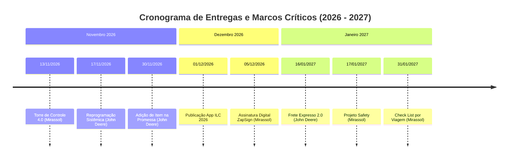
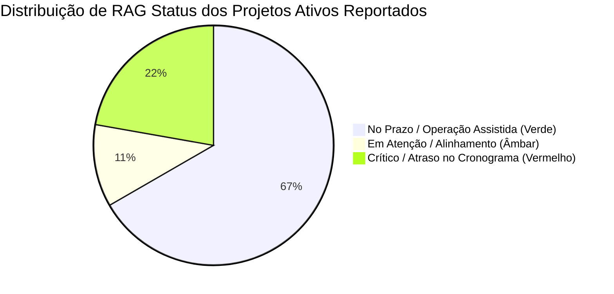

# 📋 Compromissos Assumidos com Clientes (Projetos Ativos)

> **Data Base de Análise:** Semana 45 / 2026 (Novembro/2026)  
> **Fonte de Dados:** Dashboard ILC / Azure DevOps / Status Report Executivo

Este documento consolida os **compromissos formais e entregas acordadas** com os clientes, onde cada compromisso refere-se diretamente a um **projeto ativo** em andamento na esteira de tecnologia e operações da ILC.

---

## 📑 Sumário Executivo

- [🚜 1. Cliente: John Deere](#-1-cliente-john-deere)
- [🚚 2. Cliente: Mirassol](#-2-cliente-mirassol)
- [🏢 3. Cliente: ILC (Projetos Corporativos Internos)](#-3-cliente-ilc-projetos-corporativos-internos)
- [📅 4. Linha do Tempo e Prazos Críticos](#-4-linha-do-tempo-e-prazos-críticos)
- [📊 5. Matriz de Governança e RAG Status](#-5-matriz-de-governança-e-rag-status)

---

## 🚜 1. Cliente: John Deere

| Projeto Ativo (Compromisso) | Funcionalidades / Escopo Prometido | Prazo Acordado (Prometido) | Status / Progresso |
| :--- | :--- | :---: | :---: |
| **John Deere - Adição de Item na Promessa** | • Inclusão antecipada de promessas de entrega (via XML NF-e, chave DANFE 44 dígitos, template Excel e tela no Portal Integrator). • Amarração obrigatória com Ordem de Compra (OC) ativa no ERP SAP. • Gestão dimensional de embalagens para otimização de roteirização. • Integração completa de fornecedores de materiais indiretos (treinamento já realizado). | **01/09/2026 a 30/11/2026** *(Go-Live + TEP)* | `80%` 🟢 **RAG Verde** *(Em Operação Assistida)* |
| **John Deere - Frete Expresso 2.0** | • Reestruturação e governança de ponta a ponta do Frete Expresso (Steps 01 a 06). • Portal dedicado do Transportador para cotações e propostas. • Segurança de dados com proteção Anti-IDOR. • SLA dinâmico automatizado por Cron Job. • Módulo de aprovação e gestão de custos extras. | **03/08/2026 a 16/01/2027** | `63%` 🔴 **RAG Vermelho** *(Desenvolvimento/Homologação, variação de +10 dias)* |
| **John Deere - Reprogramação Sistêmica - Duplicação de Pedidos** | • Reprogramação sistêmica de coletas no Portal Integrator. • Mecanismos contra duplicidade de pedidos, mitigando impacto operacional no SLA da operação. • Capacitação técnica e operacional das equipes envolvidas. | **01/09/2026 a 17/11/2026** | `78%` 🟢 **RAG Verde** *(Em Operação Assistida pós-treinamento)* |

> [!NOTE]
> O projeto **John Deere - Adição de Item na Promessa** e a **Reprogramação Sistêmica** encontram-se em fase final de validação operacional assistida, sem desvios de SLA registrados no período recente.

---

## 🚚 2. Cliente: Mirassol

| Projeto Ativo (Compromisso) | Funcionalidades / Escopo Prometido | Prazo Acordado (Prometido) | Status / Progresso |
| :--- | :--- | :---: | :---: |
| **Mirassol - Torre de Controle 4.0** | • Torre de Controle 4PL para gestão e visibilidade operacional de demandas das unidades Mirassol (iniciando em Cubatão). • Parametrização de eventos operacionais, geocercas e PoD digital de viagens. • Estágio *"Aguarda Execução"* para viagens não iniciadas com acompanhamento de SLA. • Painéis e BI operacional integrados ao TMS Rodopar. | **01/10/2026 a 13/11/2026** | `45%` 🔴 **RAG Vermelho** *(Desenvolvimento/Homologação, variação de +5 dias)* |
| **Mirassol - Assinatura Digital de Documentos (ZapSign)** | • Onboarding digital de motoristas e proprietários de veículos. • Assinatura eletrônica de contratos via integração API ZapSign. • Orquestração in-app no Smart Tracking com formulários do Smart X. • Liberação operacional e cadastral condicionada ao TMS Rodopar. | **31/08/2026 a 05/12/2026** | `71%` 🟡 **RAG Âmbar** *(Backend concluído; frontend em desenvolvimento)* |
| **Mirassol - Input Gestão de Demandas** | • Automação de captura e interpretação de ordens logísticas enviadas por e-mail. • Conversão de documentos em demandas estruturadas para o Integrator. • Implantação e parametrização por cliente/operação (Komatsu, LD Celulose, Sertrading, Rainbow, Ouro Fino, ICL, John Deere). | **01/05/2026 a 27/10/2026** | `100%` (Escopo) 🟢 **RAG Verde** *(Operação Assistida na Unidade Cubatão)* |
| **Mirassol - Projeto Check List por Viagem** | • Digitalização do checklist e inspeção veicular pré e pós-viagem. • Formulários dinâmicos configurados no Smart X e distribuídos aos motoristas no app Smart Tracking. | **01/08/2026 a 31/01/2027** | `5%` 🟢 **RAG Verde** *(Documentação pronta; em esteira de desenvolvimento)* |
| **Mirassol - Projeto Safety** | • Integração da plataforma educativa (Carga Online) com TMS Rodopar e Senior RH pela camada ILC. • Automação de treinamentos e reciclagens obrigatórias para motoristas a partir de eventos, infrações e sinistros. | **05/10/2026 a 17/01/2027** | `5%` 🟢 **RAG Verde** *(Fase de Planejamento e levantamento de requisitos)* |

> [!WARNING]
> O projeto **Atualização de Documentos** (Smart Tracking) atingiu 97% de progresso, mas superou a data limite acordada (04/09/2026), estando em fase de alinhamento para homologação final e encerramento.

---

## 🏢 3. Cliente: ILC (Projetos Corporativos Internos)

| Projeto Ativo (Compromisso) | Funcionalidades / Escopo Prometido | Prazo Acordado (Prometido) | Status / Progresso |
| :--- | :--- | :---: | :---: |
| **App ILC 2026** *(Status Report W45)* | • Novo aplicativo móvel unificado da ILC. • Módulos de Cockpit Logístico, Gestão de Demandas e Frete Expresso integrados. • Publicação nas lojas oficiais de aplicativos (Google Play / App Store). | **05/10/2026 a 01/12/2026** | `16%` 🟢 **RAG Verde** *(Protótipo aprovado; integração com backend)* |
| **Migração Angular Integrator V0** | • Modernização tecnológica do Portal Integrator (de JSF/XHTML legado para Angular 18+ SPA e microsserviços REST). • Nova área de autenticação, SSO, multi-tenancy e testes automatizados E2E. | **08/09/2026 a 31/10/2026** | `53%` 🔴 **RAG Vermelho** *(Homologação em atraso - 45 dias de variância)* |
| **SMART X** | • Construtor no-code de formulários customizáveis e gestão de dados com integrações (Buonny, NSTech, Rodopar, OCR Azure). | **01/07/2025 a 06/11/2026** | `98%` 🟡 **RAG Âmbar** *(Fase final de sustentação e deploy v1.2)* |
| **Gestão de Demandas (MVP)** | • Torre de controle operacional com visualização em mapa em tempo real da frota e clientes, Kanban dinâmico e integração com e-mails. | **10/11/2025 a 30/08/2026** | `87%` 🔴 **RAG Vermelho** *(Em transição para os novos módulos da Torre 4.0)* |

---

## 📅 4. Linha do Tempo e Prazos Críticos

---

## 📊 5. Matriz de Governança e RAG Status

### Principais Ações de Mitigação
1. **Frete Expresso 2.0 (John Deere)**: Aceleração da homologação das etapas de *Solicitação e Cotação* para liberar as fases de *Aprovação e Custo Extra*.
2. **Torre de Controle 4.0 (Mirassol)**: Foco na parametrização de SLAs e geocercas da unidade Cubatão para viabilizar a entrega até 13/11/2026.
3. **Assinatura Digital ZapSign (Mirassol)**: Alocação de recursos frontend para consumo dos endpoints de contrato já finalizados no backend.
