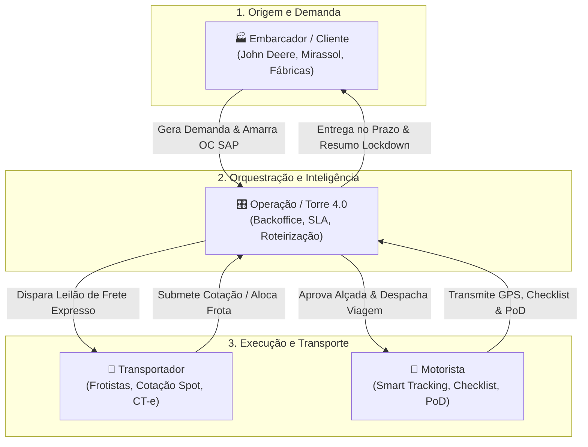
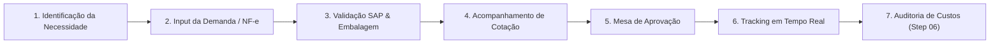
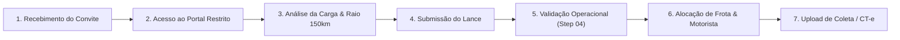
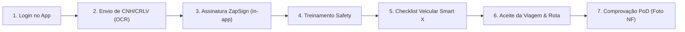
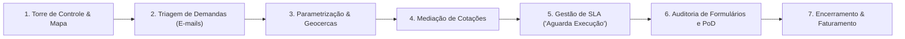
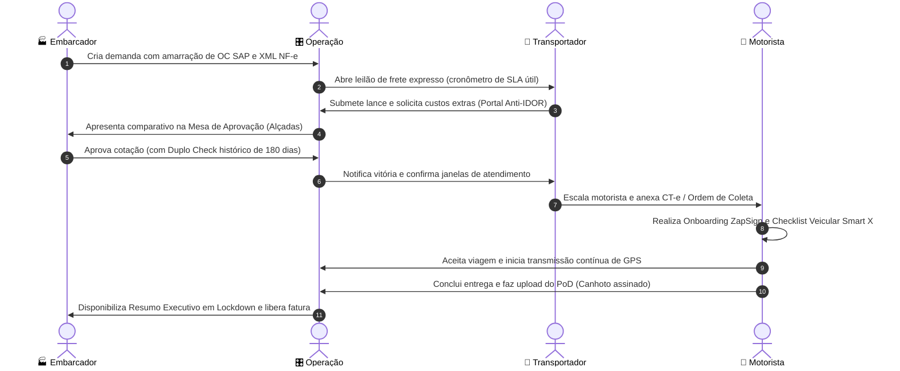

# 👥 Personas e Jornadas de Usuários

> **Data Base:** Novembro / 2026  
> **Fonte:** Wikis Oficiais do Azure DevOps (*John Deere - Frete Expresso 2.0*, *Gestão de Demandas / Torre de Controle 4.0*, *Assinatura Digital ZapSign*, *Projeto Check List por Viagem*, *Adição de Item na Promessa*, *Smart X*, *App ILC Mobile* e *Portal Integrator*)

Este documento consolida a modelagem oficial de **Personas e Jornadas de Usuários** para o ecossistema logístico da ILC e seus clientes parceiros (John Deere, Grupo Mirassol, Petrobras, entre outros).

---

## 📑 Sumário

- [🎯 1. Visão Geral do Ecossistema](#-1-visão-geral-do-ecossistema)
- [🏭 2. Persona: Embarcador](#-2-persona-embarcador)
- [🚚 3. Persona: Transportador](#-3-persona-transportador)
- [📱 4. Persona: Motorista](#-4-persona-motorista)
- [🎛️ 5. Persona: Operação (Torre de Controle & Backoffice)](#-5-persona-operação-torre-de-controle--backoffice)
- [📊 6. Matriz Comparativa de Interação e Travas](#-6-matriz-comparativa-de-interação-e-travas)
- [🔄 7. Fluxo Integrado entre Atores (Cross-Journey)](#-7-fluxo-integrado-entre-atores-cross-journey)

---

## 🎯 1. Visão Geral do Ecossistema

O ecossistema ILC conecta quatro atores fundamentais no ciclo de vida de uma operação logística:

---

## 🏭 2. Persona: Embarcador

### 👤 Perfil e Atores Reais
- **Atores:** Gestores de Logística e Supply Chain fabril (**John Deere**, **Mirassol**, **Petrobras**), Solicitantes das Linhas de Montagem, Fornecedores Industriais (ex.: Sertrading, Komatsu, LD Celulose, materiais indiretos) e Aprovadores de Centro de Custo.
- **Sistemas Utilizados:** Portal Integrator (Módulo Web), Módulo de Gestão de Demandas (Input), Painel de Promessa de Entrega e SAP ERP.

### 🎯 Objetivos e Dores
- **Objetivos:** Garantir abastecimento fabril ininterrupto (*Just-in-Time*), prever janelas de coleta com precisão, cotar fretes emergenciais e manter governança orçamentária estrita.
- **Dores:** Linha de produção parada por atraso de peças, fretes expressos caros sem concorrência transparente e caminhões bloqueados nas portarias por divergência de pedidos fiscais no ERP.

### 🗺️ Jornada Ponta a Ponta do Embarcador

1. **Geração da Demanda (First Mile):**
   - Cria a solicitação no *Portal Integrator* ou envia e-mails que são ingeridos e convertidos em ordens estruturadas pela inteligência da plataforma.
   - Informa tipo de operação (*Inbound Fábrica, Outbound Fornecedor ou Transferência*) e tipo de material (*Produtivo, Embalagem, MRO/Reposição ou Improdutivo*).
2. **Amarração Fiscal Obrigatória (Regra SAP):**
   - Amarra obrigatoriamente o número da Ordem de Compra (**OC ativa no SAP**), bloqueando qualquer carga sem pedido aprovado.
   - Faz upload do arquivo **XML NF-e 4.00**, digita a **chave DANFE (44 dígitos)** ou importa planilha Excel padronizada.
   - Define se a carga aceita aglutinação/consolidação com outras demandas em um raio de até **150 km**.
3. **Engenharia de Embalagens e Cubagem Real:**
   - Informa medidas brutas (C x L x A) ou consome o cadastro corporativo de embalagens para cálculo volumétrico e peso cubado (fator rodoviário: 300 kg/m³).
4. **Mesa de Aprovação de Fretes (Step 03 do Frete Expresso):**
   - Recebe propostas em concorrência cega (menor custo vs. menor *Transit Time*).
   - **Duplo Check:** Alerta caso o valor supere a média histórica de 180 dias para a rota.
   - **Matriz de Alçadas Sequencial:** Aprovação escalonada (*Supervisão ➔ Gerência ➔ Diretoria*). Justificativa obrigatória se rejeitar a menor proposta financeira.
5. **Visibilidade e Auditoria:**
   - Acompanha o avanço da carga via Cockpit/Torre de Controle.
   - Acessa o Resumo Consolidado (Step 06) em modo somente leitura (*Lockdown*) para auditoria financeira imutável.

---

## 🚚 3. Persona: Transportador

### 👤 Perfil e Atores Reais
- **Atores:** Transportadoras homologadas, Gestores de Frotas, Frotistas Terceirizados e Analistas de Cotação/Fretes.
- **Sistemas Utilizados:** Portal Restrito do Transportador (com isolamento Anti-IDOR), APIs de Cotação e Painel de Pedidos.

### 🎯 Objetivos e Dores
- **Objetivos:** Otimizar a utilização e capacidade dos veículos (FTL vs. Milk Run), responder lances dentro da janela de SLA útil e assegurar o recebimento de custos complementares justos.
- **Dores:** Janelas de carregamento mal informadas, diárias de estadia não remuneradas e propostas comerciais vazadas para concorrentes.

### 🗺️ Jornada Ponta a Ponta do Transportador

1. **Recepção da Cotação / Leilão Spot (Step 02):**
   - Notificação em tempo real de nova solicitação com cronômetro de SLA útil (ex.: 40 minutos).
2. **Submissão de Proposta Comercial (Portal Restrito):**
   - Autenticação restrita com proteção **Anti-IDOR** (impossibilitado de visualizar propostas concorrentes).
   - Análise de peso físico vs. cubado e rota para sugestão de aglutinação de cargas na mesma região.
   - Envio de proposta financeira, compromisso de *Transit Time* e solicitação prévia de cobranças complementares (ajudantes, dificuldade de descarga, etc.).
3. **Validação Operacional (Step 04):**
   - Em caso de vitória, ajusta e confirma as janelas operacionais de coleta e entrega (*Start Window* e *Deadline*).
4. **Alocação de Veículo e Emissão Documental (Step 05):**
   - Define a categoria do veículo (utilitário, 3/4, toco, truck, carreta ou rodotrem) e vincula o motorista escalado.
   - Emite a documentação fiscal de transporte (CT-e) e anexa a Ordem de Coleta em PDF (com trava de 25 MB).

---

## 📱 4. Persona: Motorista

### 👤 Perfil e Atores Reais
- **Atores:** Motoristas de Frota Própria, Motoristas Agregados e Motoristas Autônomos/Terceiros.
- **Sistemas Utilizados:** **App Smart Tracking** (Android/iOS) e **App ILC Mobile**.

### 🎯 Objetivos e Dores
- **Objetivos:** Iniciar viagens sem filas e burocracia, receber instruções de rota claras, cumprir normas com segurança e obter comprovação ágil para liberação de pagamentos/diárias.
- **Dores:** Papeladas manuais para vistoria, perda de viagens por cadastro travado na Gerenciadora de Risco (GR) e falta de sinal para envio de canhotos.

### 🗺️ Jornada Ponta a Ponta do Motorista

1. **Onboarding Digital e Verificação de Documentos:**
   - Login no aplicativo móvel.
   - Captura de fotos da CNH e CRLV processadas via **Azure Document Intelligence (OCR)** com validação de vencimento.
   - Se os documentos estiverem vencidos, o app aplica a **Trava da Home (*Lockout*)**, liberando apenas a opção de regularização.
2. **Assinatura Digital de Contrato (ZapSign in-app):**
   - Assinatura eletrônica de termos de adesão e subcontratação diretamente no widget do app, com biometria facial, câmera, 2FA, IP e geolocalização jurídica (sem sair para browsers externos).
3. **Capacitação Mandatória (Projeto Safety):**
   - Visualização de módulos de treinamento e reciclagem no aplicativo (integração Carga Online / Senior RH), acionados automaticamente caso o motorista tenha histórico de infrações ou sinistros.
4. **Checklist Digital de Inspeção Veicular (Smart X):**
   - Verificação das regras do Rodopar (alteração de placas ou periodicidade de 30 dias).
   - Vistoria veicular guiada:
     * **Frota Própria:** Vistoria do cavalo mecânico e da carreta.
     * **Agregado:** Vistoria focada na carreta acoplada.
   - Anexação de fotos de conservação. **Trava operacional:** enquanto o checklist estiver incompleto, o app impede o aceite da carga.
5. **Execução da Rota e Telemetria:**
   - Aceite da viagem, consulta das janelas e envio contínuo de telemetria GPS, com reconhecimento automático de geocercas nos clientes.
6. **Comprovação Digital de Entrega (PoD - Proof of Delivery):**
   - Ao descarregar, fotografa o canhoto da Nota Fiscal assinado e a placa do veículo. O app gera carimbo imutável de data/hora/GPS e conclui o ciclo.

---

## 🎛️ 5. Persona: Operação (Torre de Controle & Backoffice)

### 👤 Perfil e Atores Reais
- **Atores:** Analistas de Torre de Controle 4PL, Operadores de Backoffice Mirassol/ILC, Coordenadores Logísticos de Unidades (ex.: Cubatão, Horizontina) e Analistas de Qualidade/SLA.
- **Sistemas Utilizados:** **Torre de Controle 4.0** (Web), Mapa Interativo de Frota, Painel Administrativo Smart X e TMS Rodopar.

### 🎯 Objetivos e Dores
- **Objetivos:** Visibilidade total da frota em tempo real, proteção contra estouros de SLA, automação da triagem de demandas e sincronismo contínuo entre SAP e Rodopar.
- **Dores:** Gerenciar exceções por telefone/planilhas paralelas, perda de sinal de motoristas em áreas de sombra e divergências em cobranças complementares.

### 🗺️ Jornada Ponta a Ponta da Operação

1. **Monitoramento Ativo na Torre de Controle:**
   - Gestão visual através do Kanban de demandas e do **Mapa Interativo**: identificação instantânea de gargalos, frotas em trânsito e alertas de desvio.
   - Consulta rápida via **Super Busca** cruzando placas, ordens, clientes e motoristas.
2. **Triagem e Classificação de Ordens:**
   - Recebe solicitações manuais ou ingeridas por OCR de e-mails operacionais.
   - Define a natureza da rota: *Coleta (First Mile)*, *Transferência (Middle Mile)* ou *Entrega (Last Mile)*, aplicando regras automáticas para consolidar como *FTL* ou *Milk Run*.
3. **Gestão Preventiva de SLA e Status Críticos:**
   - Acompanhamento do estágio **"Aguarda Execução"** para demandas criadas antes do início da viagem física, prevenindo estouro de prazos contratuais.
   - Acionamento de planos de contingência em caso de avaria veicular ou ocorrência informada pelo motorista.
4. **Auditoria e Fechamento Operacional:**
   - Auditoria de dados preenchidos no Smart X. Em caso de inconsistência na documentação do motorista, aciona a função *"Solicitar Ajuste"*, permitindo correção pontual sem cancelamento integral.
   - Validação dos canhotos digitais (PoD) e transmissão das confirmações de entrega para baixa automática no TMS Rodopar.

---

## 📊 6. Matriz Comparativa de Interação e Travas

| Critério de Comparação | 🏭 Embarcador | 🚚 Transportador | 📱 Motorista | 🎛️ Operação / Torre |
| :--- | :--- | :--- | :--- | :--- |
| **Canal Principal** | Portal Integrator | Portal do Transportador | App Smart Tracking / ILC | Torre de Controle 4.0 |
| **Gatilho de Entrada** | Necessidade fabril / OC no SAP | Convite de leilão / cotação | Convocação para nova viagem | Nova demanda no sistema |
| **Ação Crítica** | Aprovar alçadas e validar dados fiscais | Submeter lance e alocar veículo | Fazer vistoria prévia e coletar PoD | Orquestrar fluxo e garantir SLA |
| **Mecanismo de Trava** | Bloqueio sem saldo/OC ativa no SAP | Bloqueio Anti-IDOR para propostas | *Lockout da Home* por pendência | Retenção de viagens divergentes |
| **Entregável Final** | Abastecimento no prazo (OTD) | Remuneração do frete contratado | Viagem concluída e diária paga | SLA operacional e relatórios executivos |

---

## 🔄 7. Fluxo Integrado entre Atores (Cross-Journey)

